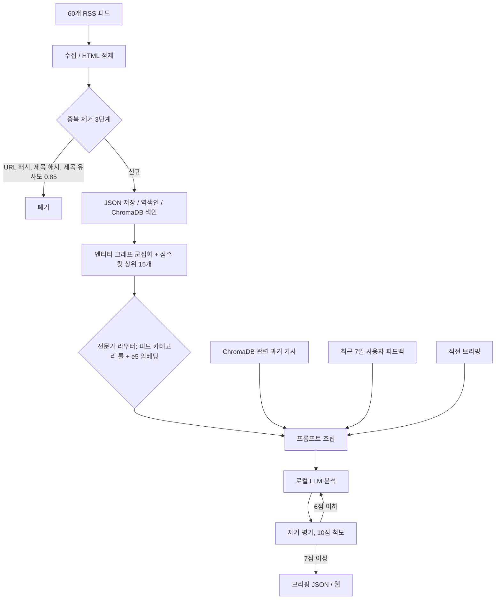

# News Briefing

로컬 LLM 기반 개인용 뉴스 분석 브리핑 시스템

## 개요

다수 언론사 RSS를 수집해 주제별로 묶고, 주요 기사 간의 흐름과 향후 전망을 분석하는 개인용 뉴스 브리핑 시스템. 직전 브리핑과 관련 과거 기사를 컨텍스트로 넣어 변화 중심으로 분석하며, 전 과정을 외부 API 없이 로컬 LLM으로 처리. 2026년 3월부터 상시 운영 중.

## 주요 기능

- RSS 피드 약 60개, 하루 8회 수집
- 3단계 중복 제거 (URL 해시, 제목 해시, 제목 유사도)
- 기사 수, 카테고리 가중치, 매체 수 점수로 상위 테마 15개 선별
- 분야별 시스템 프롬프트(전문가 9개) 라우팅. 피드 카테고리 룰을 기본으로, 임베딩 유사도로 보정
- 증분 분석. 그날 두 번째 실행부터 직전 브리핑을 이어받아 변화가 있는 테마 중심으로 재작성
- 생성 결과 자기 평가(10점 척도)와 기준 미달 테마 재생성
- LLM 출력 후처리 (다국어 혼입 제거, JSON 추출)
- 최근 7일 사용자 피드백 반영

## 아키텍처



- 수집과 분석은 `scheduler.py`의 `collect_and_analyze()` 하나로 실행 (크론, 수동 트리거 공통)
- 웹 서버와 스케줄러는 단일 프로세스

## 주요 기술 과제

- 룰과 임베딩을 결합한 전문가 라우팅. 임베딩 1위가 룰 후보보다 마진 이상 높을 때만 임베딩 교체(override) (5,692건 중 룰 69.2%, 저신뢰 라벨 임베딩 22.6%, 임베딩 교체 8.2%)
- 사이클 소요 시간(9월 기준 중앙값 39분) 제약에 맞춘 증분 분석 구조. 그날 첫 실행만 전체 분석
- 생성 결과 자기 평가와 사실 판단 배제 프롬프트 (평가 244회, 중앙값 7.0점)
- 로컬 LLM 출력 후처리로 JSON 파싱 최종 실패율 2.98% (10,492회 중 313회)
- 응답 없는 피드로 인한 34시간 수집 중단 대응. 소켓 타임아웃, 단계별 상한, 락 감시 추가
- 259MB JSON 역색인을 SQLite로 이전해 사이클당 대량 재기록 제거

## 운영 현황 (2026-03-10 ~ 09-17)

| 항목 | 값 |
|---|---|
| 완료된 수집 사이클 | 1,363회 |
| 누적 신규 저장 기사 | 628,971건 |
| LLM 호출 | 10,492회 |

상세 내용은 [docs/NOTES.md](docs/NOTES.md).

## 기술 스택

- Backend: Python, Flask, APScheduler
- AI, 검색: Ollama(`qwen3.6:35b-a3b`), ChromaDB, `intfloat/multilingual-e5-small`
- 저장: JSON, SQLite 역색인
- 운영: macOS launchd 상시 기동

## 실행

```bash
git clone https://github.com/thefirstplum/news-briefing.git && cd news-briefing
python -m venv .venv && source .venv/bin/activate
pip install -r requirements.txt

cp .env.example .env      # 값 설정
ollama pull qwen3.6:35b-a3b

python app.py             # http://localhost:3400
```

- 첫 실행 시 e5 임베딩 모델을 Hugging Face에서 다운로드
- Ollama가 꺼져 있어도 웹과 수집은 동작하고 분석만 건너뜀
- `NEWS_STORAGE_PATH`를 비워 두면 데이터는 `data/`에 저장
- 예전 JSON 역색인(`main_index.json`)이 있으면 `python scripts/migrate_index_to_sqlite.py`로 1회 이전
- 수동 수집은 `.env`의 `NEWS_COLLECT_PW`로 인증

```bash
curl -X POST -H "X-Collect-Password: <비밀번호>" http://localhost:3400/api/collect/now
```

## 디렉터리 구조

```
├── app.py              Flask 라우트, 수동 수집 인증, 피드백 API
├── scheduler.py        크론, 수집 사이클, 중복 실행 락
├── config.py           RSS 피드 60개, 카테고리, 런타임 설정
├── collectors/         피드 파싱, 중복 제거
├── analyzers/          군집화, 증분 분석, 자기 평가, LLM 클라이언트
│   └── experts/        라우터, e5 임베딩, 전문가 9개 프롬프트
├── storage/            JSON 저장, SQLite 역색인, ChromaDB
├── eval/               라우팅 정확도 골드셋, 채점 스크립트
└── scripts/            LoRA 학습 데이터 생성, 파인튜닝 (런타임 미연결), 역색인 마이그레이션
```

## 문서

- [docs/TRACE_EXAMPLE.md](docs/TRACE_EXAMPLE.md) 기사 10건이 브리핑 한 꼭지가 되는 과정
- [docs/CODE_WALKTHROUGH.md](docs/CODE_WALKTHROUGH.md) 실행 순서, 튜닝 포인트, 로그 읽는 법
- [docs/NOTES.md](docs/NOTES.md) 주요 이슈와 해결, 운영 수치, 향후 개선 과제
- [docs/AI-COLLABORATION.md](docs/AI-COLLABORATION.md) AI 도구 활용 기록
- [eval/](eval/) 라우팅 정확도 골드셋
